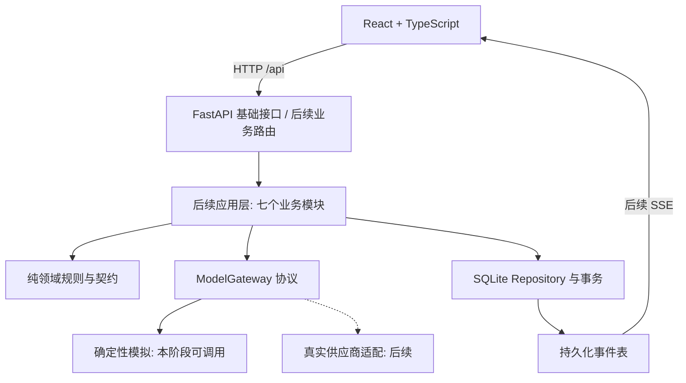

# SDD 架构基线

SDD基线：阶段2，版本0.2，2026-10-08；更新于2026-10-09。阶段4A已按TDD实现讨论管理、嘉宾生成、确认run及操作查询/持久化事件；执行细节见backend-lifecycle.md。自动发言、主持控制、观点提炼、总结和SSE仍为后续设计。最终业务契约见api.md、data-model.md；机器契约与运行时OpenAPI的范围有明确区别。

## 模块与依赖

| 模块 | 输入 → 输出 | 边界与后续实现位置 |
|---|---|---|
| 讨论管理 | 创建/开始/重试命令 → Discussion、Operation | 4A已实现：discussion_api→lifecycle/repository/tasks；生命周期、幂等和一致性查询 |
| 嘉宾生成 | 议题、人数 → RosterRevision、Participant | 4A已实现：TaskSupervisor调用ModelGateway并校验结果，repository原子提交后才READY |
| 参与意图 | 本讨论公开上下文、角色 → SpeakingIntent | 内部申请，不是正式发言；禁止隐藏推理；后续 TDD 收集 |
| 发言调度 | 本轮有效意图 → 一个获选角色 | 关联度、等待与占用仲裁，不固定轮流；后续 TDD |
| 主持人控制 | 覆盖情况、运行额度 → 追问/串联/结束 | 开场后推进，结束时冻结 transcript 边界；后续 TDD |
| 观点提取 | 截至 turn_no 的正式消息 → InsightBatch | 版本化全量洞察快照、来源引用；与总结分开；后续 TDD |
| 事件分发 | 与业务写入同事务的 Event → SSE | 每讨论有序持久化日志，读库补传；本阶段冻结协议，后续实现推送 |

Python包backend/app：contracts定义公开/模型格式，model_gateway定义异步协议与独立模拟，config/database/main提供基础设施；4A新增lifecycle纯规则、repository事务、tasks监督器和discussion_api传输层。生命周期规则不依赖FastAPI/SQLite/供应商SDK；模型通过ModelGateway调用。当前这些模块不执行自动讨论循环。

## 冻结的状态与命令规则（4A执行至RUNNING及中断；后续流程为设计）

| 当前状态 | 触发 | 目标 | 前提/失败 |
|---|---|---|---|
| DRAFT | roster-generation | GENERATING | 任务受理与操作记录同事务 |
| GENERATING | 完整阵容校验成功 | READY | 1 主持人+N 专家；失败 → FAILED/roster |
| READY | start | RUNNING | roster_revision 必须匹配；冻结阵容并创建唯一活动 run |
| RUNNING | 主持人结束/发言或时长额度达到 | SUMMARIZING | 冻结 summary_through_turn，不再接受新正式发言 |
| SUMMARIZING | 总结持久化成功 | COMPLETED | summary.ready 在最终状态事件之前提交 |
| GENERATING/RUNNING/SUMMARIZING | 不可恢复错误 | FAILED | stage=roster/discussion/summary，保留提交内容 |
| GENERATING/RUNNING/SUMMARIZING | 启动发现遗留活动任务 | INTERRUPTED | 标记原 stage；清除 SPEAKING，不自动调用模型 |
| FAILED/INTERRUPTED 且 stage=roster | 新幂等键重试 | GENERATING | 新 generation 操作；旧失败操作的相同键返回原结果 |
| FAILED/INTERRUPTED 且 stage=summary | summary-retry | SUMMARIZING | 沿用原 run、原冻结边界，只重试总结 |

其他转换一律 409 INVALID_STATE。COMPLETED、discussion 阶段 FAILED/INTERRUPTED 在本 MVP 只读；可另建讨论，无暂停/恢复/人工结束/主动重生成阵容。浏览器断连是连接状态，不改变讨论状态。角色 IDLE→PREPARING→SPEAKING→IDLE；准备取消可回 IDLE，终止/失败统一清空发言中；同 run 仅一个 SPEAKING。

启动幂等：命令需要 UUID Idempotency-Key。创建作用域 global，其他命令为 discussion_id+命令名；规范化请求摘要相同则返回原 HTTP 状态/响应，不再次排队；摘要不同返回 409 IDEMPOTENCY_CONFLICT。BEGIN IMMEDIATE 内检查状态/revision、写 run/operation/state/event 后提交，提交后受监管任务领取操作。不同键的重复 start 在该 revision 已有 run 时返回该 run，不新增任务（不论原 run 是否已终止）；旧 revision 返回 409 ROSTER_VERSION_CONFLICT。数据库唯一索引进一步阻止双 active run。

默认专家 4（2–6，不含主持人），议题 trim 后 1–500 Unicode 码点。正式消息最多 20 条（含开场/追问/串联），运行调度限 300 秒；总结额外最多 60 秒。主持人可提早结束；无人申请时追问，连续两轮无人申请则进入总结。每个调用超时 30 秒，临时网络/429 最多额外重试 2 次（1/2 秒退避，尊重 Retry-After 但不超过剩余期限），非法结构最多修复 1 次，整体期限优先；401/403 不重试。上述是普通默认值，真实成本上限待服务接入设置，不宣称已执行。

发言以 1–2 个句子数组生成，每句 1–200 码点；句界为 。！？!? 与非数字间的英文句点，连续终止标点算一个句界，句末标点可省略。缩写含句点易误判，模拟/提示词使用完整词；最终正式消息拼接后 ≤400 码点。总结独立自然语言字段（≤4000 码点），不作为 1–2 句短发言。语义质量仍需人工检查。

## 四层隔离

1. 数据库：所有子记录显式 discussion_id，run/roster/participant/message 引用通过复合外键保证同议题、同 run/阵容；Repository 查询必须以 discussion_id 起始，不提供跨议题“最近发言”。本阶段已建立这些结构性约束。
2. 运行任务：未来单 Uvicorn worker、任务注册表以 discussion_id/operation_id 标识，每议题锁和 run/roster 版本守卫；至多 3 活动讨论，模型 IO 全局并发 4；不因观察者数量新增任务。此调度未实现。
3. 模型上下文：不可变请求携带 discussion_id、run_id、participants、messages；构造/校验拒绝外来归属。服务适配器不共享可变聊天历史；后续上下文预算为公开滚动摘要+最近消息，按本 run 构建；不读取 Codex 历史或凭据。
4. 订阅：每页一条 `/discussions/{id}/events`，按该 id 查询日志，发送事件再次校验归属；前端切换议题关闭旧连接、清空投影并重新取快照。不同议题 seq 相同合法，不可把 seq 当全局 ID。

## 快照与事件交接协议

快照在一个 SQLite 读事务内读取当前角色、消息、洞察、总结、状态及 last_event_seq=k。这既防止半更新快照，也定义去重边界。客户端渲染后订阅 `after=k`。服务端每轮只查询持久化 events WHERE discussion_id=? AND seq>cursor ORDER BY seq LIMIT 100；不足时等待最多 250ms 再查，不依赖易丢失的内存通知。事件提交在快照之后、连接之前或补传期间都将被后续查询读到；无需“先补历史再接内存流”的竞态交接。未来可以用通知唤醒，但数据库游标仍为事实来源。

自动重连有效 Last-Event-ID 优先于 after，完整刷新重新取快照。ID 形式 `discussion_uuid:seq`；不同 discussion 前缀、负数、非整数、游标超出现有高水位返回 409 CURSOR_INVALID；所有读请求先做存在性校验。seq 严格 +1，客户端丢弃 ≤已应用游标，对跳号或未知 schema_version 关闭连接并重新取快照；禁止悄悄跳过。MVP 不清理事件，删除功能不开放；若未来压缩，过期游标返回 409 SNAPSHOT_REQUIRED。

`: heartbeat` 每 15 秒无 ID；数据 `retry: 2000` 建议重连间隔；UTF-8/text-event-stream、Cache-Control no-cache、X-Accel-Buffering no。终止状态事件到达且其 seq 已应用后客户端主动关闭，避免 EventSource 自动重连循环。生成阶段 READY 仍允许连接继续等 start；失败/中断关闭后，用户重试命令再取快照并新建订阅。慢消费者从持久化日志拉取，无无界内存队列；后续设置写入超时断开后仍可补传。本阶段只实现契约和格式验证，不启动 SSE 路由。

## 工程与安全边界

本阶段运行路由只有 `/api/health/live`、`/api/health/ready`、`/api/system` 与 FastAPI 文档；其余核心契约尚未挂载，实际请求返回统一 404，不冒充业务成功。前端通过 Vite 同源 `/api` 代理访问后端，前端根不读取项目 .env，不使用 VITE_* 传模型配置。后端限定默认 loopback，无身份系统，不对公网发布。

日志白名单仅含生成的 request_id、HTTP 方法、匹配的路由模板、状态和耗时；不记录请求 body/query/header、模型上下文/输出、环境值和异常原文。关闭 Uvicorn access log；统一错误不回显 Pydantic input/ctx 或原始异常；未匹配路径记录固定 `<unmatched>`。配置中密钥用 SecretStr，禁止 dump 配置。真实适配器尚未实现，非 mock 模式 readiness 返回 503。

迁移顺序、结构性约束、模型校验及基础错误用自动检查验证；实际任务隔离、SSE 断线重连、调度与崩溃恢复留在阶段 4/5 按 TDD/E2E 验证。
