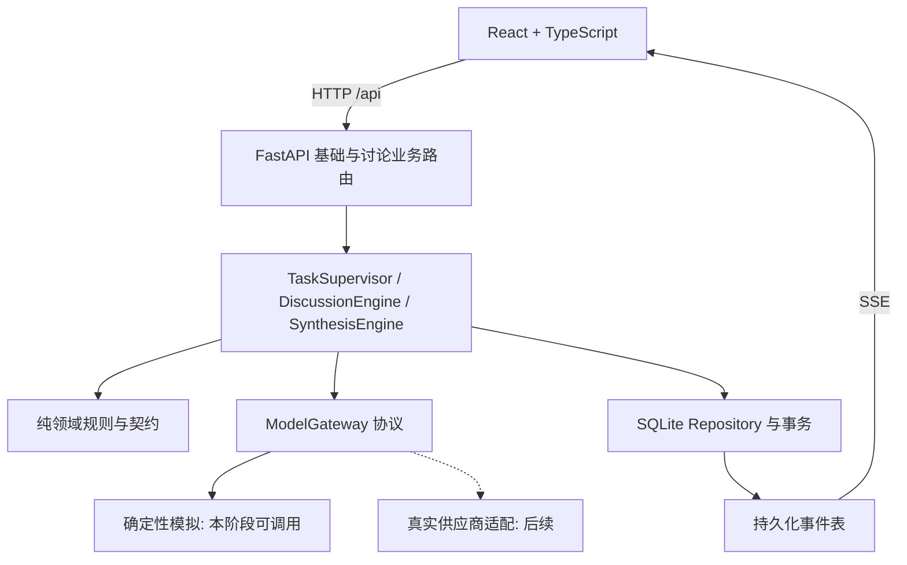

# SDD 架构基线

SDD基线：阶段2，2026-10-08；更新于2026-10-10。4A生命周期、4B自主调度、4C观点提取/自然语言总结/恢复均完成对应后端验证。确定性模式自动到COMPLETED；阶段5已接通SSE与前端业务并完成替身下真实服务E2E；真实模型留阶段6。模块细节见backend-lifecycle、backend-orchestration和backend-synthesis。

## 模块与依赖

| 模块 | 输入 → 输出 | 边界与后续实现位置 |
|---|---|---|
| 讨论管理 | 创建/开始/重试命令 → Discussion、Operation | 4A/4C已实现：discussion_api→repository/tasks；生命周期、启动及总结重试幂等和一致性查询 |
| 嘉宾生成 | 议题、人数 → RosterRevision、Participant | 4A已实现：TaskSupervisor调用ModelGateway并校验结果，repository原子提交后才READY |
| 参与意图 | 本讨论公开上下文、角色 → SpeakingIntent | 4B已实现：并发评估、归属/target验证、结构化意图保存；不进入正式消息 |
| 发言调度 | 本轮有效意图 → 一个获选角色 | 4B已实现：纯评分/回应/近期惩罚与连续占用回退，唯一领取及消息提交 |
| 主持人控制 | 公开上下文、运行额度 → 追问/串联/结束 | 4B已实现：开场先行，无候选追问、专家发言后串联、决定结束冻结边界 |
| 观点提取 | 正式消息冻结前缀 → InsightBatch/InsightStatus | 4C已实现：SynthesisEngine/SynthesisRepository，来源/版本/领取、原子事件与有限失败；总结单独捕获边界 |
| 事件分发 | 与业务写入同事务的 Event → SSE | 每讨论有序持久化日志，读库补传；阶段5已挂载SSE短事务读库及补发 |

Python包backend/app：contracts定义公开/模型格式，model_gateway定义协议与独立模拟，config/database/main提供基础设施；4A的lifecycle/repository/tasks/discussion_api已扩展为4B的scheduling纯仲裁、run_repository事务和engine自动循环。纯领域规则不依赖FastAPI/SQLite/供应商SDK；全部模型IO通过ModelGateway执行。

## 状态与命令规则（4C已执行至COMPLETED及总结恢复）

| 当前状态 | 触发 | 目标 | 前提/失败 |
|---|---|---|---|
| DRAFT | roster-generation | GENERATING | 任务受理与操作记录同事务 |
| GENERATING | 完整阵容校验成功 | READY | 1 主持人+N 专家；失败 → FAILED/roster |
| READY | start | RUNNING | roster_revision 必须匹配；冻结阵容并创建唯一活动 run |
| RUNNING | 主持人结束/发言或时长额度达到 | SUMMARIZING | 冻结 summary_through_turn，不再接受新正式发言 |
| SUMMARIZING | 总结持久化成功 | COMPLETED | summary.ready 在最终状态事件之前提交 |
| GENERATING/RUNNING/SUMMARIZING | 不可恢复错误 | FAILED | stage=roster/discussion/summary，保留提交内容 |
| GENERATING/RUNNING/SUMMARIZING | 启动发现遗留活动任务 | INTERRUPTED | 标记原 stage；清除 SPEAKING，不自动调用模型 |
| FAILED/INTERRUPTED 且 stage=roster | 新幂等键重试 | GENERATING | 新 generation 操作；旧失败操作的相同键返回原结果 |
| FAILED/INTERRUPTED 且 stage=summary | summary-retry | SUMMARIZING | 沿用原 run、原冻结边界，只重试总结 |

其他转换一律 409 INVALID_STATE。COMPLETED、discussion 阶段 FAILED/INTERRUPTED 在本 MVP 只读；可另建讨论，无暂停/恢复/人工结束/主动重生成阵容。浏览器断连是连接状态，不改变讨论状态。角色 IDLE→PREPARING→SPEAKING→IDLE；准备取消可回 IDLE，终止/失败统一清空发言中；同 run 仅一个 SPEAKING。

启动幂等：命令需要 UUID Idempotency-Key。创建作用域 global，其他命令为 discussion_id+命令名；规范化请求摘要相同则返回原 HTTP 状态/响应，不再次排队；摘要不同返回 409 IDEMPOTENCY_CONFLICT。BEGIN IMMEDIATE 内检查状态/revision、写 run/operation/state/event 后提交，提交后受监管任务领取操作。不同键的重复 start 在该 revision 已有 run 时返回该 run，不新增任务（不论原 run 是否已终止）；旧 revision 返回 409 ROSTER_VERSION_CONFLICT。数据库唯一索引进一步阻止双 active run。

默认专家4（2–6，不含主持人），议题trim后1–500码点；默认最多20条正式消息、运行300秒，主持可提前结束，无候选时追问。每2条正式消息提取一次，提取总预算10秒；总结独立60秒。模型每次超时30秒，全局并发4、最多2次尝试（含首次），总预算优先；没有额外“连续无人申请自动结束”规则。真实429/鉴权/费用策略待适配接入，不把设计建议写成现行行为。

发言以 1–2 个句子数组生成，每句 1–200 码点；句界为 。！？!? 与非数字间的英文句点，连续终止标点算一个句界，句末标点可省略。缩写含句点易误判，模拟/提示词使用完整词；最终正式消息拼接后 ≤400 码点。总结独立自然语言字段（≤4000 码点），不作为 1–2 句短发言。语义质量仍需人工检查。

## 四层隔离

1. 数据库：所有子记录显式 discussion_id，run/roster/participant/message 引用通过复合外键保证同议题、同 run/阵容；Repository 查询必须以 discussion_id 起始，不提供跨议题“最近发言”。本阶段已建立这些结构性约束。
2. 运行任务：单Uvicorn worker、单数据库所有者；run_tasks/scheduled_runs保证run最多一个讨论循环，summary_jobs唯一PENDING及summary_tasks/scheduled_summaries保证手动重试任务唯一。默认3活动讨论、模型全局并发4；受理/关闭/SQLite线程统一收集，轮次/领取/取消标记拒绝迟到结果。
3. 模型上下文：不可变请求携带 discussion_id、run_id、participants、messages；构造/校验拒绝外来归属。服务适配器不共享可变聊天历史；后续上下文预算为公开滚动摘要+最近消息，按本 run 构建；不读取 Codex 历史或凭据。
4. 订阅：每页一条 `/discussions/{id}/events`，按该 id 查询日志，发送事件再次校验归属；前端切换议题关闭旧连接、清空投影并重新取快照。不同议题 seq 相同合法，不可把 seq 当全局 ID。

## 快照与事件交接协议

快照在一个 SQLite 读事务内读取当前角色、消息、洞察、总结、状态及 last_event_seq=k。这既防止半更新快照，也定义去重边界。客户端渲染后订阅 `after=k`。服务端每轮只查询持久化 events WHERE discussion_id=? AND seq>cursor ORDER BY seq LIMIT 100；不足时等待最多 250ms 再查，不依赖易丢失的内存通知。事件提交在快照之后、连接之前或补传期间都将被后续查询读到；无需“先补历史再接内存流”的竞态交接。未来可以用通知唤醒，但数据库游标仍为事实来源。

自动重连有效 Last-Event-ID 优先于 after，完整刷新重新取快照。ID 形式 `discussion_uuid:seq`；不同 discussion 前缀、负数、非整数、游标超出现有高水位返回 409 CURSOR_INVALID；所有读请求先做存在性校验。seq 严格 +1，客户端丢弃 ≤已应用游标，对跳号或未知 schema_version 关闭连接并重新取快照；禁止悄悄跳过。MVP 不清理事件，删除功能不开放；若未来压缩，过期游标返回 409 SNAPSHOT_REQUIRED。

`: heartbeat` 每 15 秒无 ID；数据 `retry: 2000` 建议重连间隔；UTF-8/text-event-stream、Cache-Control no-cache、X-Accel-Buffering no。终止状态事件到达且其 seq 已应用后客户端主动关闭，避免 EventSource 自动重连循环。生成阶段 READY 仍允许连接继续等 start；失败/中断关闭后，用户重试命令再取快照并新建订阅。慢消费者从持久化日志拉取，无无界内存队列；后续设置写入超时断开后仍可补传。阶段5已实现SSE路由与恢复检查。

## 工程与安全边界

当前运行路由包括三个基础接口及创建、列表、快照、嘉宾生成、启动、总结重试和操作查询；包括SSE持久化事件订阅。前端默认通过统一HTTP/SSE客户端，独立台本仅在mode=mock；全部业务请求通过Vite同源代理访问后端，不读取根.env。后端默认loopback，无身份系统，不对公网发布。

日志白名单仅含生成的 request_id、HTTP 方法、匹配的路由模板、状态和耗时；不记录请求 body/query/header、模型上下文/输出、环境值和异常原文。关闭 Uvicorn access log；统一错误不回显 Pydantic input/ctx 或原始异常；未匹配路径记录固定 `<unmatched>`。配置中密钥用 SecretStr，禁止 dump 配置。真实适配器尚未实现，非 mock 模式 readiness 返回 503。

迁移、模型边界、任务隔离、调度/提取/总结及恢复均有后端检查；阶段5另有真实SSE、前端业务投影与完整浏览器E2E；真实模型留阶段6。

## 4C-1运行中观点更新

SynthesisRepository继承RunRepository，新增领取/归属/最新版本守卫和观点事务；SynthesisEngine复用已验证的有限模型调用机制，使用独立INSIGHT_MAX_SECONDS。DiscussionEngine在每2条正式消息提交后调用提取，TaskSupervisor在正常结束/时长结束后补最后边界。当前采用串行有限提取以保持公开事件顺序；提取等待计入讨论实际运行时长，失败后继续推进。模型IO全在事务外，失败仅影响最新提取状态，已有观点保留。总结/恢复已由4C-2/3完成，详见backend-synthesis。

## 4C-2主持人总结

TaskSupervisor在讨论循环正常/预算结束后执行最终提取和总结；SynthesisEngine每次任务独立计时，不继承DiscussionEngine的到期deadline。持久化summary_jobs领取与状态守卫阻止重复/中断结果提交，SynthesisRepository从冻结边界和捕获观点版本重建请求后校验，完成事务保证总结及状态一致。失败仅进入FAILED/summary，保留已提交消息和观点，手动恢复接口已由4C-3实现。

## 4C-3恢复与任务监督

summary-retry受理在单写事务内校验FAILED/INTERRUPTED/summary、容量与冻结边界，重置原run活动状态、创建操作和新领取并切SUMMARIZING。并发键加入同一领取与规范操作响应，所有别名操作随该结果更新。持久化领取与进程scheduled_summaries双重守卫；服务关闭取消并收集所有任务、排空SQLite工作后统一标记中断。模型若吞取消后返回，call_model以closing/cancelling标记拒绝返回结果。

## 阶段5事件读侧

SSE路由→短事务event_page→异步stream。持久化events是唯一业务流来源，不通过内存广播代替补发。快照与event_page各自读取一致高水位；从快照seq开始即可覆盖交接窗口，不要求订阅锁住生产者。没有观察者也照常推进，断连不通知引擎停止。每连接独立游标，无写入领取、无长期数据库事务。轮询与心跳阈值是实现默认值，不是题目要求。单进程限制继续有效。

观点状态是独立公开事件，避免靠失败后刷新碰巧发现状态，也避免将旧观点删除。005迁移在一个事务内复制events、替换CHECK并恢复连续/不可变触发器；不改001–004校验和、旧事件或讨论高水位。

## 阶段5前端连接与恢复

统一composition入口transport/client选择默认HttpDiscussionClient，显式mode=mock才动态加载台本及浏览器记录。页面和hooks不导入mock。流使用fetch+可取消reader读取标准SSE，校验帧id/type/讨论/schema及seq，注释心跳只更新40秒连接活性监测，不投影消息。HTTP10秒预算，命令UUID幂等键；创建表单同参数失败重发保持同键，创建成功后即便阵容受理失败也进入已创建讨论以便重试。

useDiscussion先快照后after订阅，重复seq忽略，缺口/旧run/格式异常关闭旧reader，保留内容并以1/2/4/8/10秒退避重新读取快照与续订。generation和alive同时守卫fetch和连接回调；切场组件key及cleanup清理timer/AbortController/订阅。终态保留内容并关闭订阅；总结重试受理后显式重新快照，不重放消息。恢复不会重建同场Transcript，原阅读位置和新内容提示继续生效。观点任务状态与成功观点内容分离，FAILED/INTERRUPTED显示独立提示并保留旧批次。

服务关闭：生产Uvicorn宽限5秒，开放的SSE不会无限阻止lifespan清理；宽限后取消观察者流，再由TaskSupervisor取消/收集后台任务并持久化中断。仅断开观察者不触发此服务关闭过程。真实TCP补测保留未关闭reader，证明进程能退出并保存INTERRUPTED/discussion。流网络离线主动abort、在线立即快照恢复。SSE流故障注入仅位于backend/tests/e2e_server.py，生产create_app没有_test接口。

## 阶段6A：真实模型边界

DeepSeekGateway以stateless HTTP实现ModelGateway，任务Prompt在backend/prompts，public_context只映射本场角色及正式消息。所有六类任务经DiscussionEngine.call_model的唯一超时/重试控制；阵容不再另写一次性调用策略。DB仍只接收经契约验证的绑定结果，模型IO在事务外，关闭先收集任务后关闭共享HTTP client。生产没有验证故障路由或指标查询接口。安全system公开mock/real/unavailable而非凭provider名称猜测，ready不付费探测。[详细规则](model-provider.md)。

6A内容复核后，供应商观点采用公开逐字来源片段守卫：格式/归属失败不提交，保留已有业务观点。Prompt候选最大2共识/2分歧是内容建议，结构来源并非语义证明。验证脚本可注入安全metrics_sink逐请求落盘，生产默认不落盘不公开。已提交旧内容不由Prompt修改自动重写；定向质量复核不改变数据库。[实际证据及限制](quality-first-round.md)。

阶段6A续批保留六任务与自主调度。真实观点/总结采用任务内draft→review，只有经复核和结构校验的最终结果进入原事务；不新增业务消息或事件类型。角色人设仅供intent/utterance，证据任务不消费人设。观点仅传专家发言但内部仍按完整已提交前缀校验，summary回读全部冻结发言。来源、版本、取消和事务守卫不变。模型checks不是语义证明，实际内容验收另列；细节见[模型边界](model-provider.md)。

最终摘要将原文精选、已有观点选择及有限待核对标签组装为可读正文，阻止自由改写备选条件或再生成另一套共识分歧；不引入领域任务/数据库迁移。模型生成的public_focus是未核实提示，回应target_message与作者由后端绑定。真实浏览器保留原场，不自动改写已提交内容；修正只在定向复测中验证，保守漏提等限制见[质量修正验收](quality-revision.md)。

验收收尾：SynthesisRepository领取时注入上一成功批次；DeepSeek的review候选为已校验新草稿+前批候选，并检查全新前缀，允许重新选择原来源引文来收窄最小共同主张，not_superseded检查撤回/条件变化。程序不机械union最终结果；事务仍提交完整新批次，个别无依据候选被剔除。摘要条数/长度、疑问标记和重复片段约束在适配边界，不在前端改写。默认提取预算15秒；旧.env值优先需显式配置，原失败证据不变。

### 阶段6A验收收尾的上游模式

DeepSeek六任务允许后端配置thinking.type=enabled，统一预算仍覆盖排队、每次草稿/逐项复核及有限重试；关闭/取消守卫不变。只消费content，HTTP层不处理reasoning_content。观点旧批次是逐来源重新核对的候选；同一逐字证据集合去重，后续撤回可以删除，不机械累积。词形来源守卫仅保守过滤，语义证明来自真实输出人工复核。外部HTTP/SSE及SQLite schema没有迁移。

预算修正：多请求适配器可以声明multi_step_synthesis能力。引擎对观点/总结使用有限总任务截止时间，适配器对每个HTTP显式设置MODEL_TIMEOUT_SECONDS；避免把多段合法请求累计时间误认为单次HTTP超时。排队、退避与有限重试均不延长总预算，取消仍拒绝迟到结果。普通任务和未声明能力的网关继续原单次超时规则，不改变自主调度。

随后真实402暴露SQLite错误码约束缺口，006迁移扩展两个任务表允许值，保留归属/唯一约束和既有数据。正常失败继续原事务发布状态/事件；已遗留PENDING经原启动恢复标INTERRUPTED，不自动重播。迁移和失败恢复已通过真实FastAPI/SQLite检查。用户充值后最终0465f68完整真实流程与本批核心内容复核通过，4批观点/8消息/总结与113事件正常；原失败证据不覆盖，召回不穷举，详见quality-acceptance.md。
