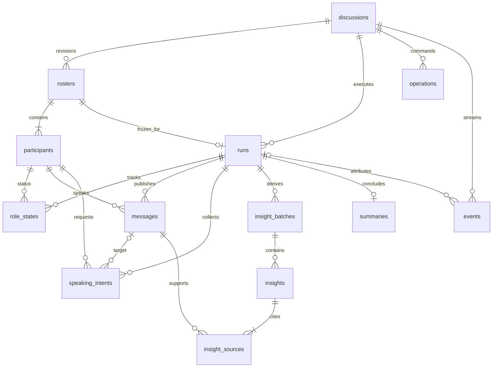

# 数据模型与 SQLite 约束

阶段 2，2026-10-09。物理 schema 已建立，业务写入流程后续实现。唯一事实来源分别为 `db/migrations/001_initial.sql`（存储）和 `backend/app/contracts.py`（公开/模型边界）；导出的 JSON Schema 见 `contracts/schema.json`。

## ER 图

`rosters` 生成期间可以暂时无 participant，ER 的完整阵容关系只描述 READY 后状态；`insight_sources` 至少一条属于应用完整性校验，数据库外键仅保证存在及归属。不能把 ER 图的业务基数误认为全部已由 SQL 强制。

## 公共约定

- API ID 是 UUID 字符串；DB 用 TEXT 保存，UUID 格式在 Pydantic 边界校验，SQL 不强制 UUID 正则。时间是带时区的 ISO 8601，服务输出使用 UTC Z，前端按本地时间展示。
- SQLite STRICT 表约束存储类型，外键在每条连接开启；版本/轮次/序号使用 INTEGER。REST/事件/模型对象均 extra=forbid，不接受任意额外字段；所有应用字符串 trim，关键文本非空。
- 所有子表保留 discussion_id；复合外键把 run、阵容、角色、消息引用限定在同一讨论。角色的同一阵容下 ID、name、color 唯一；颜色为 `#RRGGBB` 大写十六进制。
- 正式消息只能是开场/陈述/追问/串联，不保存举手为 transcript；参与意图单独表。公开 focus 与隐藏推理无关，不建立 reasoning/chain_of_thought 字段。
- 数据库 schema 本身不驱动状态转换、不调用模型、不自动恢复任务；这些是未来应用事务的责任。

## 字段字典

| 表 / 主键 | 核心字段与类型 | 关系、约束及默认值 |
|---|---|---|
| discussions / id | topic TEXT；expert_count INT；state TEXT；version INT；roster_revision INT；current_run_id TEXT?；failure_stage TEXT?；last_event_seq INT；created_at/updated_at TEXT | topic trim 后 1–500；专家 2–6 默认4；state 默认 DRAFT；version/revision/游标默认0；current_run 复合外键同讨论、延迟到事务提交检查；failure_stage=roster/discussion/summary |
| rosters / (discussion_id,revision) | confirmed_at TEXT? | revision≥1；FK→discussion；生成完整后可读，确认后不可编辑（应用规则）；重新生成成功使用新 revision，失败草稿不公开 |
| participants / id | discussion_id；roster_revision；kind；name；title；stance；color | kind=HOST/EXPERT；name1–50、title1–100、stance1–140；复合 FK→roster；独立唯一索引最多1主持人；应用提交前要求恰好1主持人+N专家 |
| runs / id | discussion_id；roster_revision；status；max_turns；max_seconds；summary_through_turn INT?；started_at/ended_at | status=ACTIVE/COMPLETED/FAILED/INTERRUPTED；默认 ACTIVE/20/300；一阵容最多一个 run；一讨论最多一个 ACTIVE；总结重试沿用原 run；FK→roster |
| role_states / (discussion_id,run_id,participant_id) | roster_revision；state；public_focus；version | IDLE/PREPARING/SPEAKING；focus≤140；version≥0；复合 FK 同时校验 run 的 roster 与 participant 的 roster；部分唯一索引一 run 最多一个 SPEAKING |
| messages / id | discussion_id；run_id；roster_revision；participant_id；turn_no；kind；content；created_at | turn_no≥1 且同 run 唯一；kind=opening/statement/followup/linking；content1–400；公开模型另外限制1–2句；归属 run/角色/阵容均由复合 FK 检查 |
| speaking_intents / id | discussion_id；run_id；roster_revision；participant_id；cycle；based_on_turn；kind；target_message_id?；relevance；public_focus | cycle≥1、based_on_turn≥0；同角色同 cycle 唯一；kind=PASS/REQUEST/INTERRUPT/SUPPLEMENT/REBUT；后两者必须有 target；target FK 限同 run；relevance0–100 |
| insight_batches / (discussion_id,run_id,version) | through_turn | version≥1；through_turn≥0；FK→run；API 无提炼时使用 version=0 的空投影，不入表；只公开最新提交版本 |
| insights / (discussion_id,run_id,batch_version,id) | kind；content | kind=consensus/disagreement；content1–500；FK→batch；每一批是完整替代集合，允许空集合，不强造共识 |
| insight_sources / (discussion_id,run_id,batch_version,insight_id,message_id) | 无额外字段 | 双复合 FK 同时指向 insight 与同 run message；引用不能晚于 batch.through_turn 由应用验证 |
| summaries / (discussion_id,run_id) | content；through_turn；created_at | content1–4000；自然语言，不返回供应商 JSON；through_turn≥0；FK→run；一个 run 最多一个成功总结 |
| operations / id | discussion_id?；scope；kind；idempotency_key；request_hash；status；response_status；response_json；error_code? | 唯一(scope,kind,key)；create scope=global，其他 scope=discussion_id；request_hash=64字符十六进制摘要文本（SQL限制长度，应用验证编码）；status=ACCEPTED/RUNNING/SUCCEEDED/FAILED/INTERRUPTED；response_json 必须合法 JSON，存原受理响应供重放 |
| events / (discussion_id,seq) | run_id?；schema_version；type；occurred_at；payload JSON文本 | schema_version=1；type 有限枚举；FK→discussion及同讨论run；seq从1开始连续；触发器拒绝跳号、更新、删除，插入同事务推进 discussion.last_event_seq；JSON形状另由契约校验 |
| schema_migrations / version | name；checksum；applied_at | 迁移器维护；已应用脚本 SHA-256 不可改变；不属于业务 API |

## 关键写入事务设计

阶段4A已实现创建、嘉宾受理/完成/失败、start和中断恢复在BEGIN IMMEDIATE内同时更新业务、操作与对应事件；正式发言、洞察、总结事务留下一批。取last_event_seq+1插入，触发器原子推进；后续SSE只读取已提交事件。任何写入错误整体回滚，不能有部分阵容或成功通知。Repository先通过EventAdapter与Snapshot验证跨字段约束，SQL json_valid本身只验证JSON语法。001迁移未修改，新增逻辑复用既有表/索引。

快照使用一个读事务，同一版本中的 participants/messages/insights/summary 和事件高水位一起读取。并发写入通过 WAL 读写隔离；SQLite 仍是单写者，5 秒 busy timeout；应用未来遇忙再做有界退避。网络等待绝不放在写事务中。

已实施的SQL约束测试：跨讨论角色引用被拒绝；run不能重复启动；同时发言者唯一；事件跳号、跨讨论run被拒绝；迁移失败回滚。阶段4A应用测试补齐合法生成/启动状态、revision检查、完整阵容与事件提交、幂等/并发、写入失败全回滚、迟到回调守卫、关闭及重启中断。待后续：当轮有效申请、公平仲裁、消息/事件同事务领域写入、summary前置条件及完整运行结束。

## 初始化与迁移

入口：在项目根执行 `.venv\Scripts\python.exe -m backend.app.database`，或 `--path work/check.sqlite3` 使用独立文件。服务启动也运行同一幂等迁移器。目录不存在则创建，文件不存在则初始化，重复运行已应用版本返回空列表且保留数据。

迁移命名为连续 `001_*.sql`、`002_*.sql`。每次读取历史并核对所有 SHA-256，在 `BEGIN IMMEDIATE` 内依次执行完整 SQL 语句和写版本记录；本批任一失败回滚整批。使用 `sqlite3.complete_statement` 拆分包括触发器在内的完整语句，不用会隐式提交的 executescript。`.gitattributes` 固定 SQL LF，避免系统换行差异改变迁移校验值。已应用脚本改动、版本缺口、数据库比代码新均拒绝运行。

只支持前向迁移，无自动降级、drop/recreate 或清库；需要破坏性变更时后续单独设计数据迁移与备份。SQLite≥3.37 支持 STRICT；本机实际版本记录在 progress。JSON/CSV 样例与迁移入 Git，本地 `.db/.sqlite3`、WAL/SHM 及 `.env` 不入 Git。本阶段 `data/samples/contracts.json` 是结构示例，不算最终五条高质量讨论样例。
