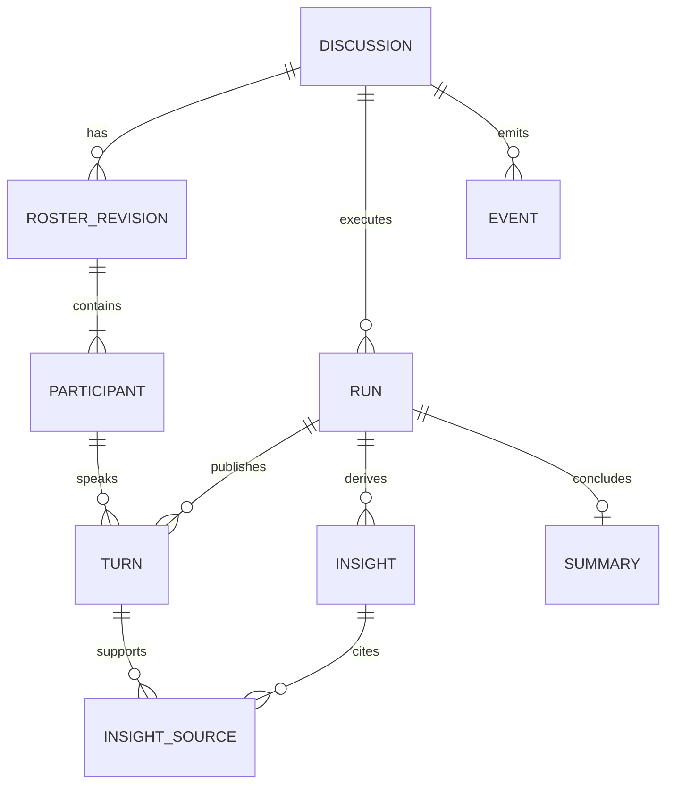

# 技术决策与待确认事项

日期：2026-10-08；所有方案均为规划，尚无运行验证。题目要求见 requirements 中来源 A，用户要求见 U；下述具体架构是实现建议。

## 1. 方案评估与决策

| ID / 状态 | 选择与理由 | 备选及代价 | 验证时点 |
|---|---|---|---|
| ADR-01 / 采纳用户偏好 | React + TypeScript + Vite，适合状态密集的本地单页演播厅；TypeScript 检查事件/状态结构 | SSR 框架对当前无 SEO 的本地工具增加复杂性；原生 JS 的契约检查较弱 | 阶段 2 锁版本，阶段 3 构建/类型检查 |
| ADR-02 / 采纳用户偏好 | FastAPI，请求/响应校验与 OpenAPI，异步编排模型 IO | Flask 需自行整合更多异步契约；全 Node 方案与用户优先栈不符 | 阶段 2 契约，阶段 4 集成 |
| ADR-03 / 题目硬约束 | SQLite；常规 WAL、外键、迁移、短事务、有界 busy timeout；网络模型调用放事务外 | PostgreSQL 适合扩容但违反本次数据库要求；JSON 文件难保证多讨论一致性 | 阶段 4 隔离、锁竞争与恢复测试 |
| ADR-04 / 采纳 | POST/GET HTTP 命令与查询 + SSE 单向推送；更贴合观看体验 | WebSocket 支持双向实时但增加协议管理，本阶段无高频用户输入需求 | 阶段 5 重连和多讨论 E2E |
| ADR-05 / 建议基线 | 单 FastAPI 进程中受监管的异步任务，按讨论串行调度，多讨论并发；生命周期由 lifespan 管理 | 无监管 fire-and-forget 难处理关闭和失败；多 worker 可能重复调度；分布式队列超 MVP | 阶段 4 模拟重启；阶段 5 至少两议题并发 |
| ADR-06 / 用户要求 | 独立运行时 ModelGateway 接口及后端 ProviderAdapter，配置和测试替身注入 | 把 SDK 调用散在路由/组件会绑定供应商且难 TDD | 阶段 2 接口冻结；阶段 6 真实适配验证 |
| ADR-07 / 建议基线 | 公共发言完成校验并提交后推送，另实时发送小窗状态；MVP 不依赖逐 token 展示 | token 流能更早展示但引入撤回/未提交内容一致性复杂度 | Q-04；阶段 5 验证可感知的实时性 |
| ADR-08 / 采纳 | pytest 测领域及集成，Playwright 测完整浏览器链路，固定模型替身、时钟和随机性 | 仅真实 LLM 测试成本高且不确定；仅前端 API mock 无法证明后端/SSE/SQLite 通路 | 阶段 4–6 |
| ADR-09 / 建议基线 | 应用表 + 同事务写入的持久化事件表，提交后广播，便于快照/补传 | 全量事件溯源与复杂 CQRS 不适合当前规模；仅内存推送丢失重连窗口 | 阶段 4 原子性、阶段 5 补传 |
| ADR-10 / 建议基线 | 中文纯文本内容，稳定角色颜色+文字；嵌套布局内部滚动 | 直接渲染模型 HTML 有注入风险；仅靠颜色无法明确区分角色 | 阶段 3 视觉核对与阶段 5 E2E |

SQLite WAL 允许读写并行，但仍只有一个写入者，所以“多个议题并行”应落实为并发模型 IO 与短时串行提交，不能宣称任意多写入并行。[SQLite 官方 WAL 文档](https://www.sqlite.org/wal.html)

SSE 使用 UTF-8 事件流、事件 ID 和心跳。EventSource 可在连接恢复时携带 Last-Event-ID；完整页面刷新仍需应用自行获取快照与游标。浏览器对 HTTP/1.x 同源 SSE 连接数有限制，MVP 每个演播厅页只建一条 SSE 连接，共享该讨论各面板事件。[MDN SSE 文档](https://developer.mozilla.org/en-US/docs/Web/API/Server-sent_events/Using_server-sent_events)

FastAPI 用 lifespan 管理启动、关闭及受监管任务的清理；它不等于可靠队列，也不能保证进程崩溃后自动续跑。[FastAPI 官方生命周期文档](https://fastapi.tiangolo.com/advanced/events/)

Vite 提供 React TypeScript 模板；版本、Node/Python 兼容矩阵在实际搭建时再锁定。[Vite 官方指南](https://vite.dev/guide/)。E2E 优先使用 Playwright 自动重试断言等待可见状态，不使用任意固定 sleep 充当同步。[Playwright 官方断言文档](https://playwright.dev/docs/test-assertions)。后端 fixture、参数化与清理遵循 [pytest 官方指南](https://docs.pytest.org/en/stable/how-to/index.html)。以上为 2026-10-08 阅读的主来源，只支持设计选择，不代表本机依赖已安装或运行通过。

## 2. SDD、DDD 与领域边界

附件明确将 SDD 关联“数据建模与 API 契约”，将 DDD 关联“前端组件与页面生成”，没有展开缩写。本计划把 SDD 操作性定义为规格驱动，把附件 DDD 操作性定义为设计驱动 UI 阶段；另采用领域驱动设计（Domain-Driven Design）组织后端。两种 DDD 含义不混用，Q-08 保留术语核对。

领域词汇：Discussion（议题与生命周期）、Participant（主持人/专家）、RosterRevision（阵容版本）、SpeakingIntent（内部申请）、Turn（公开发言）、Insight（共识/分歧）、Summary（公开总结）、Run（一次执行）、Event（对外可见状态变化）。

| 边界 | 职责与实体 | 不变式 |
|---|---|---|
| 讨论管理 | Discussion 聚合根、Run、RosterRevision、Participant | 确认前不能运行；恰好 1 主持人和 N 专家；同一讨论只有一个活动 run |
| 讨论编排 | 意图收集、仲裁、主持人策略、Turn | 同一场至多一人公开发言；已提交发言有稳定 turn_id 与单调顺序；不能固定轮询冒充自主选择 |
| 洞察与总结 | Insight 版本、来源 turn_id、Summary | 不跨议题引用；不超越已提交 transcript；总结成功才能 COMPLETED |
| 基础设施 | SQLite Repository、ModelGateway、SSE publisher | 不能绕过领域状态校验；事件与业务记录同事务；密钥不持久化 |

分层建议：domain（规则和纯函数）→ application（命令、查询、任务编排，依赖接口）← infrastructure（数据库和模型适配）；API 转换协议；前端消费公开契约。模型生成候选与内容，领域代码负责约束、调度仲裁、幂等与状态推进。

概念模型（非最终数据库 schema）：

建议唯一约束：(discussion_id, seq)、(run_id, turn_no)、(discussion_id, command_type, idempotency_key)。跨表归属通过约束或显式事务校验确保一致。公开摘要、洞察与模型返回结构分开；不存储或索取隐藏推理内容。

## 3. API 和事件契约方向（阶段 2 才冻结）

| 候选接口 | 用途 | 关键约束 |
|---|---|---|
| POST /api/discussions | 创建议题和人数 | 校验、幂等键；不默认开始讨论 |
| GET /api/discussions?status=active | 首页查询 | active 包含 RUNNING/SUMMARIZING，其他状态另选；分页策略阶段 2 定义 |
| POST /api/discussions/{id}/roster-generation | 请求生成或按允许状态重试 | 返回任务与当前状态；重复请求不重复付费执行 |
| GET /api/discussions/{id} | 取得可渲染快照 | 含 roster_revision、run_id、状态、已提交内容和 last_event_seq |
| POST /api/discussions/{id}/start | 用户确认并开始 | 带 roster_revision + 幂等键；过期返回 409 |
| GET /api/discussions/{id}/events?after={seq} | 补传后继续 SSE | 只输出本 discussion 的公开事件，Last-Event-ID 与 after 的优先级须定义 |
| POST /api/discussions/{id}/summary-retry | 总结失败后的有限重试 | 已成功时幂等返回；不重新生成已有发言 |

HTTP 错误建议：404 不存在、409 非法状态/版本冲突、422 参数错误、503 配置缺失/暂时不可用；异步失败写入可见状态与 error_code，不依赖已结束的 HTTP 请求。错误包含脱敏说明、可重试标志和 request_id，不返回原始供应商堆栈。

事件包建议：schema_version、discussion_id、run_id（运行前可空）、seq、type、occurred_at、payload。事件包括 roster.ready、discussion.state_changed、participant.status_changed、turn.committed、insights.updated、summary.ready、operation.failed。内部 SpeakingIntent 不进入公开 transcript；前端只把 turn.committed 放入 transcript。

事件恢复协议：在一致性快照内取得业务内容和游标 k → 请求 k 之后的事件 → 服务端订阅与补传衔接保证无缺口 → 客户端按 seq 去重、按归属校验 → 缺口/游标过期要求重取快照。终态事件处理完后关闭连接。建议 MVP 保留本地讨论事件至讨论数据删除，不设置短保留窗口。广播失败仍可从数据库重放。

## 4. 运行时模型配置与测试隔离

建议后端配置名：MODEL_PROVIDER、MODEL_BASE_URL、MODEL_NAME、MODEL_API_KEY、MODEL_TIMEOUT_SECONDS、MODEL_MAX_CONCURRENCY。确切协议/认证头/结构化输出能力待 Q-09；这些名字不是已实现接口。`.env.example` 后续仅存占位符；浏览器只看到连接是否可用与脱敏错误，永远不收到模型 Key。

ModelGateway 需要覆盖阵容生成、专家意图、公开短发言、洞察提炼、主持总结；不假定所有供应商支持同一 JSON schema 或 token 流。模型输出作为不可信数据，经过解析、验证、有限修复后才入库。模型调用附 discussion/run/request 标识，仅用于隔离与脱敏诊断。

正常开发与 CI 不依赖密钥或付费网络：使用显式标记的 DeterministicModelGateway，在真实 API、SSE、SQLite 通路下测试。真实适配器的超时、限流、格式失败用 HTTP 模拟；真实服务另做 opt-in 冒烟，记录模型配置（不含密钥）、用例、成本/时延和质量观察。

## 5. 待确认事项与默认建议

未获得回复不等于批准。以下均不阻塞第 1 阶段；标为实施前/真实接入前/交付前的事项在相应门槛解决。可逆技术参数可在授权实施后明确记录暂定值。

| ID | 歧义与影响 | 当前建议/处理 | 需要解决的时点 |
|---|---|---|---|
| Q-01 | 附件允许任意工具，却要求描述 Claude Code + Deepseek V4 Pro | 当前实际工具 Codex，如实记录；已提出可选澄清，尚未获答，不伪造附件工具经历 | 最终工作流说明前；若评审强制则实现开始前 |
| Q-02 | 专家人数是否含主持人、上下限、输入长度未定义 | 主持人另计；专家默认 4、建议 2–6；议题 trim 后 1–500 Unicode 码点 | 阶段 2 契约冻结 |
| Q-03 | 讨论何时结束、预算与性能期望未定义 | 建议最多 20 次公开发言（含主持开场/追问，不含最终总结）或 5 分钟，主持人可提早结束；真实价格与预算另配 | 阶段 2 策略冻结；真实服务前预算确认 |
| Q-04 | “实时”是否必须逐 token，公开“思考摘要”定义 | MVP 推送短句级完整发言和实时状态；摘要仅“将从成本角度回应”等可公开说明 | 阶段 2 体验契约；若必须 token 流需重估 |
| Q-05 | 是否支持人工结束、编辑/重新生成阵容 | MVP 必须生成+确认；建议只增加失败重试，主动重新生成和手动结束暂不承诺 | 阶段 2 MVP 冻结 |
| Q-06 | 可录制/回放在画像中出现，功能列表未要求 | 保留文本和总结回看；音视频录制、时间轴重放不纳入 | 阶段 2 范围确认 |
| Q-07 | 72 小时起算、姓名、邮箱拼写、远程平台及提交格式未核实 | 不推算截止日期，不发送；最终按用户确认的起算时刻和提交信息整理 | 最终交付前 |
| Q-08 | SDD/DDD 缩写未展开 | 同时满足规格/API、前端设计、领域建模；明确不同含义 | 阶段 2 开始时核对 |
| Q-09 | 运行时供应商、模型、协议、凭据未指定 | 后端适配器+测试替身先行，不默认复用 Codex 模型 | 阶段 6 真实接入前 |
| Q-10 | 多议题数量上限、允许的浏览器/窗口大小未指定 | 最低证明 2 个讨论同时推进；建议并发上限 3，视口 1920×1080、1366×768、390×844 | 阶段 2 定基线，阶段 5 验证 |

## 6. 风险与应对

| 风险 | 影响 | 应对与验收证据 |
|---|---|---|
| 多专家调用成本与延迟增长 | 4 专家每轮都请求可能放大开销 | 有界并发、短上下文、最多发言/时长、预留总结预算；记录真实时延与调用数 |
| “自主”退化为轮询或单人独占 | 不满足附件核心体验 | 意图基于 transcript，仲裁考虑关联/等待/占用；固定案例和真人观感双重检验 |
| 提炼与发言不同步、事实幻觉 | 错误共识/总结 | 洞察版本关联 turn 边界与来源；落后可见；人工质量样例复核 |
| 崩溃、重连造成重复生成或缺口 | 付费重复、记录不一致 | 幂等键、持久化事件、快照游标、run 约束；故障注入验证 |
| SQLite 写竞争和多 worker 重入 | 多议题串线/重复任务 | 单应用 worker、每讨论锁、短事务、唯一约束与隔离测试；限制作为 README 明示 |
| 仅替身测试掩盖真实服务问题 | 演示与验收落差 | 自动 E2E 与真实服务冒烟分别标记；真实服务缺失时保留未验证状态 |
| 工具组合和截止时间不明 | 最终材料不被接受 | Q-01、Q-07 单独待确认，保留过程原文和真实 Git 历史 |
