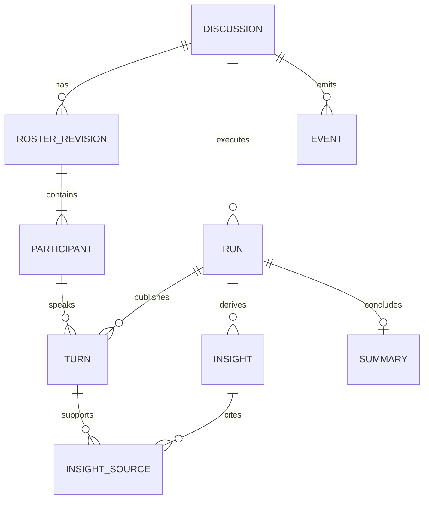

# 技术决策与待确认事项

更新：2026-10-09；阶段1的设计推理保留，阶段2的冻结决定与实际基础验证见第7节。完整引擎仍是设计，不能与已运行的工程基础混为一谈。题目要求见 requirements 中来源 A，用户要求见 U。

## 1. 方案评估与决策

| ID / 状态 | 选择与理由 | 备选及代价 | 验证时点 |
|---|---|---|---|
| ADR-01 / 采纳用户偏好 | React + TypeScript + Vite，适合状态密集的本地单页演播厅；TypeScript 检查事件/状态结构 | SSR 框架对当前无 SEO 的本地工具增加复杂性；原生 JS 的契约检查较弱 | 阶段 2 锁版本，阶段 3 构建/类型检查 |
| ADR-02 / 采纳用户偏好 | FastAPI，请求/响应校验与 OpenAPI，异步编排模型 IO | Flask 需自行整合更多异步契约；全 Node 方案与用户优先栈不符 | 阶段 2 契约，阶段 4 集成 |
| ADR-03 / 题目硬约束 | SQLite；常规 WAL、外键、迁移、短事务、有界 busy timeout；网络模型调用放事务外 | PostgreSQL 适合扩容但违反本次数据库要求；JSON 文件难保证多讨论一致性 | 阶段 4 隔离、锁竞争与恢复测试 |
| ADR-04 / 采纳 | POST/GET HTTP 命令与查询 + SSE 单向推送；更贴合观看体验 | WebSocket 支持双向实时但增加协议管理，本阶段无高频用户输入需求 | 阶段 5 重连和多讨论 E2E |
| ADR-05 / 建议基线 | 单 FastAPI 进程中受监管的异步任务，按讨论串行调度，多讨论并发；生命周期由 lifespan 管理 | 无监管 fire-and-forget 难处理关闭和失败；多 worker 可能重复调度；分布式队列超 MVP | 阶段 4 模拟重启；阶段 5 至少两议题并发 |
| ADR-06 / 用户要求 | 独立运行时 ModelGateway 接口及后端 ProviderAdapter，配置和测试替身注入 | 把 SDK 调用散在路由/组件会绑定供应商且难 TDD | 阶段 2 接口冻结；阶段 6 真实适配验证 |
| ADR-07 / 建议基线 | 公共发言完成校验并提交后推送，另实时发送小窗状态；MVP 不依赖逐 token 展示 | token 流能更早展示但引入撤回/未提交内容一致性复杂度 | Q-04；阶段 5 验证可感知的实时性 |
| ADR-08 / 采纳 | pytest 测领域及集成，Playwright 测完整浏览器链路，固定模型替身、时钟和随机性 | 仅真实 LLM 测试成本高且不确定；仅前端 API mock 无法证明后端/SSE/SQLite 通路 | 阶段 4–6 |
| ADR-09 / 建议基线 | 应用表 + 同事务写入的持久化事件表，提交后广播，便于快照/补传 | 全量事件溯源与复杂 CQRS 不适合当前规模；仅内存推送丢失重连窗口 | 阶段 4 原子性、阶段 5 补传 |
| ADR-10 / 建议基线 | 中文纯文本内容，稳定角色颜色+文字；嵌套布局内部滚动 | 直接渲染模型 HTML 有注入风险；仅靠颜色无法明确区分角色 | 阶段 3 视觉核对与阶段 5 E2E |

SQLite WAL 允许读写并行，但仍只有一个写入者，所以“多个议题并行”应落实为并发模型 IO 与短时串行提交，不能宣称任意多写入并行。[SQLite 官方 WAL 文档](https://www.sqlite.org/wal.html)

SSE 使用 UTF-8 事件流、事件 ID 和心跳。EventSource 可在连接恢复时携带 Last-Event-ID；完整页面刷新仍需应用自行获取快照与游标。浏览器对 HTTP/1.x 同源 SSE 连接数有限制，MVP 每个演播厅页只建一条 SSE 连接，共享该讨论各面板事件。[MDN SSE 文档](https://developer.mozilla.org/en-US/docs/Web/API/Server-sent_events/Using_server-sent_events)

FastAPI 用 lifespan 管理启动、关闭及受监管任务的清理；它不等于可靠队列，也不能保证进程崩溃后自动续跑。[FastAPI 官方生命周期文档](https://fastapi.tiangolo.com/advanced/events/)

Vite 提供 React TypeScript 模板；版本、Node/Python 兼容矩阵在实际搭建时再锁定。[Vite 官方指南](https://vite.dev/guide/)。E2E 优先使用 Playwright 自动重试断言等待可见状态，不使用任意固定 sleep 充当同步。[Playwright 官方断言文档](https://playwright.dev/docs/test-assertions)。后端 fixture、参数化与清理遵循 [pytest 官方指南](https://docs.pytest.org/en/stable/how-to/index.html)。以上为 2026-10-08 阅读的主来源，只支持设计选择，不代表本机依赖已安装或运行通过。

## 2. SDD、DDD 与领域边界

附件明确将 SDD 关联“数据建模与 API 契约”，将 DDD 关联“前端组件与页面生成”，没有展开缩写。本计划把 SDD 操作性定义为规格驱动，把附件 DDD 操作性定义为设计驱动 UI 阶段；另采用领域驱动设计（Domain-Driven Design）组织后端。两种 DDD 含义不混用，Q-08 保留术语核对。

领域词汇：Discussion（议题与生命周期）、Participant（主持人/专家）、RosterRevision（阵容版本）、SpeakingIntent（内部申请）、Turn（公开发言）、Insight（共识/分歧）、Summary（公开总结）、Run（一次执行）、Event（对外可见状态变化）。

| 边界 | 职责与实体 | 不变式 |
|---|---|---|
| 讨论管理 | Discussion 聚合根、Run、RosterRevision、Participant | 确认前不能运行；恰好 1 主持人和 N 专家；同一讨论只有一个活动 run |
| 讨论编排 | 意图收集、仲裁、主持人策略、Turn | 同一场至多一人公开发言；已提交发言有稳定 turn_id 与单调顺序；不能固定轮询冒充自主选择 |
| 洞察与总结 | Insight 版本、来源 turn_id、Summary | 不跨议题引用；不超越已提交 transcript；总结成功才能 COMPLETED |
| 基础设施 | SQLite Repository、ModelGateway、SSE publisher | 不能绕过领域状态校验；事件与业务记录同事务；密钥不持久化 |

分层建议：domain（规则和纯函数）→ application（命令、查询、任务编排，依赖接口）← infrastructure（数据库和模型适配）；API 转换协议；前端消费公开契约。模型生成候选与内容，领域代码负责约束、调度仲裁、幂等与状态推进。

概念模型（非最终数据库 schema）：

建议唯一约束：(discussion_id, seq)、(run_id, turn_no)、(discussion_id, command_type, idempotency_key)。跨表归属通过约束或显式事务校验确保一致。公开摘要、洞察与模型返回结构分开；不存储或索取隐藏推理内容。

## 3. API 和事件契约方向（阶段 2 才冻结）

| 候选接口 | 用途 | 关键约束 |
|---|---|---|
| POST /api/discussions | 创建议题和人数 | 校验、幂等键；不默认开始讨论 |
| GET /api/discussions?status=active | 首页查询 | active 包含 RUNNING/SUMMARIZING，其他状态另选；分页策略阶段 2 定义 |
| POST /api/discussions/{id}/roster-generation | 请求生成或按允许状态重试 | 返回任务与当前状态；重复请求不重复付费执行 |
| GET /api/discussions/{id} | 取得可渲染快照 | 含 roster_revision、run_id、状态、已提交内容和 last_event_seq |
| POST /api/discussions/{id}/start | 用户确认并开始 | 带 roster_revision + 幂等键；过期返回 409 |
| GET /api/discussions/{id}/events?after={seq} | 补传后继续 SSE | 只输出本 discussion 的公开事件，Last-Event-ID 与 after 的优先级须定义 |
| POST /api/discussions/{id}/summary-retry | 总结失败后的有限重试 | 已成功时幂等返回；不重新生成已有发言 |

HTTP 错误建议：404 不存在、409 非法状态/版本冲突、422 参数错误、503 配置缺失/暂时不可用；异步失败写入可见状态与 error_code，不依赖已结束的 HTTP 请求。错误包含脱敏说明、可重试标志和 request_id，不返回原始供应商堆栈。

事件包建议：schema_version、discussion_id、run_id（运行前可空）、seq、type、occurred_at、payload。事件包括 roster.ready、discussion.state_changed、participant.status_changed、turn.committed、insights.updated、summary.ready、operation.failed。内部 SpeakingIntent 不进入公开 transcript；前端只把 turn.committed 放入 transcript。

事件恢复协议：在一致性快照内取得业务内容和游标 k → 请求 k 之后的事件 → 服务端订阅与补传衔接保证无缺口 → 客户端按 seq 去重、按归属校验 → 缺口/游标过期要求重取快照。终态事件处理完后关闭连接。建议 MVP 保留本地讨论事件至讨论数据删除，不设置短保留窗口。广播失败仍可从数据库重放。

## 4. 运行时模型配置与测试隔离

建议后端配置名：MODEL_PROVIDER、MODEL_BASE_URL、MODEL_NAME、MODEL_API_KEY、MODEL_TIMEOUT_SECONDS、MODEL_MAX_CONCURRENCY。确切协议/认证头/结构化输出能力待 Q-09；这些名字不是已实现接口。`.env.example` 后续仅存占位符；浏览器只看到连接是否可用与脱敏错误，永远不收到模型 Key。

ModelGateway 需要覆盖阵容生成、专家意图、公开短发言、洞察提炼、主持总结；不假定所有供应商支持同一 JSON schema 或 token 流。模型输出作为不可信数据，经过解析、验证、有限修复后才入库。模型调用附 discussion/run/request 标识，仅用于隔离与脱敏诊断。

正常开发与 CI 不依赖密钥或付费网络：使用显式标记的 DeterministicModelGateway，在真实 API、SSE、SQLite 通路下测试。真实适配器的超时、限流、格式失败用 HTTP 模拟；真实服务另做 opt-in 冒烟，记录模型配置（不含密钥）、用例、成本/时延和质量观察。

## 5. 待确认事项与默认建议

未获得回复不等于批准。以下均不阻塞第 1 阶段；标为实施前/真实接入前/交付前的事项在相应门槛解决。可逆技术参数可在授权实施后明确记录暂定值。

| ID | 歧义与影响 | 当前建议/处理 | 需要解决的时点 |
|---|---|---|---|
| Q-01 | 附件工具示例歧义 | **已关闭，用户U3明确**：Claude Code、DeepSeek均为工具示例；实际使用Codex如实记录 | 无需再确认 |
| Q-02 | 人数及输入范围 | **已按U3默认值权限冻结**：主持人另计，专家默认4、2–6；议题trim后1–500码点 | 阶段2契约与测试已落实 |
| Q-03 | 终止/预算 | **默认策略已冻结**：20条正式消息或300秒，主持可提前结束，总结另留60秒；真实费用额度仍待服务配置 | 真实服务前核对费用预算 |
| Q-04 | 实时粒度和公开摘要 | **默认已冻结**：完整短句级事件，不逐token；focus为专门的公开说明 | SSE实际实现留阶段4/5 |
| Q-05 | 人工结束/主动重生成 | **范围已冻结**：只有失败重试，主动重生成/编辑/人工结束不纳入MVP | 不阻塞后续实现 |
| Q-06 | 录制/回放 | **范围已冻结**：文本与总结回看；音视频录制和时间轴重放不纳入 | 不阻塞后续实现 |
| Q-07 | 72 小时起算、姓名、邮箱拼写、远程平台及提交格式未核实 | 不推算截止日期，不发送；最终按用户确认的起算时刻和提交信息整理 | 最终交付前 |
| Q-08 | SDD/DDD 缩写 | **解释已固定**：本阶段规格/API/领域建模；下一阶段设计驱动前端，领域设计贯穿后端 | 已在AGENTS/architecture说明 |
| Q-09 | 运行时供应商、模型、协议、凭据未指定 | 后端适配器+测试替身先行，不默认复用 Codex 模型 | 阶段 6 真实接入前 |
| Q-10 | 并发/视口 | **默认已冻结**：活动讨论3、模型IO并发4，最低证明2议题同时推进；U4新增2560×1080，四种视口按阶段3强制验证 | 前端模拟演播厅已实现；真实并行留阶段5 |

## 6. 风险与应对

| 风险 | 影响 | 应对与验收证据 |
|---|---|---|
| 多专家调用成本与延迟增长 | 4 专家每轮都请求可能放大开销 | 有界并发、短上下文、最多发言/时长、预留总结预算；记录真实时延与调用数 |
| “自主”退化为轮询或单人独占 | 不满足附件核心体验 | 意图基于 transcript，仲裁考虑关联/等待/占用；固定案例和真人观感双重检验 |
| 提炼与发言不同步、事实幻觉 | 错误共识/总结 | 洞察版本关联 turn 边界与来源；落后可见；人工质量样例复核 |
| 崩溃、重连造成重复生成或缺口 | 付费重复、记录不一致 | 幂等键、持久化事件、快照游标、run 约束；故障注入验证 |
| SQLite 写竞争和多 worker 重入 | 多议题串线/重复任务 | 单应用 worker、每讨论锁、短事务、唯一约束与隔离测试；限制作为 README 明示 |
| 仅替身测试掩盖真实服务问题 | 演示与验收落差 | 自动 E2E 与真实服务冒烟分别标记；真实服务缺失时保留未验证状态 |
| 截止与提交信息未明确 | 最终材料交付安排不确定 | Q-07仍待确认；Q-01已按用户说明关闭，保留真实工具历史 |

## 7. 阶段2冻结与实现记录

| ID | 决策 | 证据与限制 |
|---|---|---|
| ADR-11 | 本阶段运行API只开放健康与安全系统信息；完整目标API另导出OpenAPI，逐操作标记x-implemented | 未实现路由不回假成功；未来业务与SSE均为false |
| ADR-12 | SSE以持久化事件表轮询补传（100条/批、空闲250ms、心跳15秒），Last-Event-ID优先，事件ID包含议题UUID | 消除补历史切内存订阅的交接缺口；本阶段只定义，不声称实时性/恢复已运行 |
| ADR-13 | SQLite标准库+顺序SQL迁移，不引入ORM/迁移框架；STRICT、复合FK、部分唯一索引、SHA-256历史校验、整批事务回滚 | 已测试初始化/重复/回滚/历史改动拒绝；SQL固定LF；后续复杂迁移再评估框架 |
| ADR-14 | 锁定当前可安装版本：React/DOM19.3.0、TS7.0.2、Vite8.3.4、plugin-react6.1.2；FastAPI0.143.0、Pydantic2.14.0、settings2.15.0、Uvicorn0.54.0；pytest9.1.1、Playwright1.64.0 | Node24.18/Python3.12.10/SQLite3.49.1本机验证；完整传递版本见两个锁文件，不声称其他OS已验证 |
| ADR-15 | 配置从后端.env/进程环境读取，环境优先；Key使用SecretStr并从model_dump排除；系统接口只白名单字段 | 哨兵密钥测试检查响应/日志；前端仅代理不读根.env；真实provider未实现返回not ready |
| ADR-16 | 阵容、结构化短句、任务身份、上下文归属和模型结果在统一协议边界校验；模拟无网络且无共享可变历史 | 原始输入不进入异常；模型请求/结果格式验证与调度决策不同，后者仍后续TDD |
| ADR-17 | Windows本机默认npm缓存无写权限，使用项目内.cache；沿用可达的npm镜像生成锁文件，不修改全局配置 | npm安装、ci及构建实际检查；镜像可达性属于安装环境依赖 |

运行服务默认loopback、单worker，不提供公网访问/认证保证。关于错误处理采用统一FastAPI异常转换，参考 [FastAPI官方错误处理](https://fastapi.tiangolo.com/tutorial/handling-errors/)；配置行为参考 [Pydantic Settings官方说明](https://docs.pydantic.dev/latest/concepts/pydantic_settings/)；每连接开启外键依据 [SQLite官方外键说明](https://www.sqlite.org/foreignkeys.html)。这些来源用于接口与基础设施实现决策，真实验证结果见progress。

## 8. 阶段3前端决策

| ID | 决策 | 理由与边界 |
|---|---|---|
| ADR-18 | 以DiscussionClient隔离页面与模拟数据，采用hash路由和React hooks，不新增路由/状态依赖 | 当前页面层级有限；真实HTTP/SSE接入时替换适配器，后端供应商信息不进入页面 |
| ADR-19 | 预设16条正式发言，5次观点事件；公开关注点与正式消息分开 | 验证回应/反驳、过程中提炼和最终总结；不是自主讨论引擎，不按输入话题重新生成 |
| ADR-20 | 前端模拟使用按讨论隔离的localStorage快照、事件、计时器和订阅；断线后快照再补发 | 验证页面消费协议与恢复呈现；没有SQLite持久化或网络SSE保证，不支持跨标签页合并 |
| ADR-21 | 桌面三个独立滚动面板；超宽限制Transcript760px；1000px以下分区切换；长话题可展开 | 四个用户指定视口均须真实浏览器检查；上翻时不跟随新发言，来源跳转可切换窄屏分区 |
| ADR-22 | 演示故障与播放控制统一放在可折叠工具菜单，并持续标记模拟模式 | 暂停/加速只是台本演示控制；不引入人工结束/暂停领域状态。故障后保留发言并提供相应重试 |

前端脚本的普通默认参数：正常1200ms/事件组、加速220ms，快照90ms和列表180ms模拟延迟，接近底部48px自动跟随。生成过程中刷新会恢复为可重试失败；已开始的台本从保留位置继续。仅模拟服务使用这些参数，真实后端仍遵循阶段2契约。

## 9. 阶段4第一批实现决策

| ID | 决策 | 理由与验证边界 |
|---|---|---|
| ADR-23 | 复用001表结构；Repository以BEGIN IMMEDIATE同时写业务/操作/事件，一致性读事务生成Snapshot | 不改已应用迁移；创建、完整阵容、启动事件写失败均验证整体回滚；网络等待在事务外 |
| ADR-24 | 规范化请求持久化幂等；同revision不同start键返回首个成功操作和既有run，另记键映射操作 | 并发同键/不同键只能创建1run；终态后重放不续跑，当前状态读Snapshot；重复请求先于容量检查 |
| ADR-25 | lifespan统一管理受理/模型任务，单worker/单数据库所有者，关闭等待SQLite线程写入后恢复未完成工作 | 线程取消不等于数据库取消；未完成操作/运行显式INTERRUPTED，无自动重复模型调用；数据库持续不可写时待下次可写启动恢复 |
| ADR-26 | 容量3计GENERATING/RUNNING/SUMMARIZING，模型并发4/超时30秒；失败生成只接受新key重试 | READY不占工作容量，start重新校验；max_turns20/max_seconds300只冻结到run，本批无自动额度终止 |
| ADR-27 | 后端system版本0.4.0/phase4，discussion_engine_available仍false；前端继续阶段3mock | 已有生命周期接口不等于完整自动讨论；只调整基础浏览器测试的phase断言，不修改演播厅布局或模拟数据 |

上述为本批实现选择及合理默认值，不冒充附件新增硬要求。真实供应商、网络自动重试/修复、SSE、发言与总结循环后续按既有契约逐批实现；Q-01工具示例关闭状态保持。

## 10. 阶段4B实现决策

| ID | 决策 | 理由与边界 |
|---|---|---|
| ADR-28 | 按run_id登记唯一后台讨论任务，完成/失败/总结后不重调度；应用统一取消与收集 | 同key/不同key重复start验证只有一次开场；不引入多worker队列 |
| ADR-29 | cycle+base_turn+领取记录守卫；message_id=claim_id；002前向迁移保持001 | 唯一待提交领取及单SPEAKING，重复/迟到/写失败不能破坏已提交投影 |
| ADR-30 | 仲裁相关性+回应类型/新近性−近期惩罚，禁止立即连发，稳定UUID同分裁决 | 无固定轮流；默认权重见backend-orchestration，真实模型体验需后续人工评估 |
| ADR-31 | 最多2次模型尝试；全局并发4，队列/模型均受run预算，区分调用超时与预算到期 | 真实10秒慢模型测试暴露计时边界误分类，按timeout作用域expired分类后通过；数据库写失败不自动重试 |
| ADR-32 | 到额度或主持end即冻结边界至SUMMARIZING，当前不调用insights/summary | 避免在下一批完成前假称COMPLETED；重启待总结工作显式INTERRUPTED/summary |
| ADR-33 | 独立后端确定性Gateway根据角色/上下文生成意图和任务短句；可控模型构造故障 | 不引用前端台本，结构/调度验证与真实模型内容质量分开；完整引擎可用标志仍false表示尚缺最终总结链路 |

专家意图部分失败时跳过该专家并显示固定公开提示，全部失败或主持/发言耗尽尝试则结束本run为FAILED；不自动重启失败讨论。真实适配响应取消及供应商费用行为留后续接入验证。

## ADR-34：4C观点证据与有限提取（已采用，实现建议）

每2条正式发言后提取，结束补尾；串行提取简化一致事件顺序，有限总预算10秒、最多2次尝试。每项共识/分歧至少有两位不同专家正式消息来源，证据不足为空；该结构条件不是语义事实保证。领取版本递增、每边界唯一、只有最新领取可提交，失败保留最新成功批次并在下一新边界处理。快照insight_status独立展示失败，避免错误清空业务观点。003迁移保持已提交001/002不变。

## ADR-35：冻结边界与独立总结预算（已采用）

总结单独计时默认60秒，包含队列等待并沿用每次超时及最多2次尝试；不复用讨论截止时间。主持请求包含完整冻结消息前缀和捕获版本的最新成功观点；正文拒绝可解析JSON与代码块，完整语义须未来真实模型复核。持久化summary_jobs与唯一PENDING索引保护唯一提交，总结/成功事件/COMPLETED同事务并加数据库触发器。自动总结使用空operation_id，失败事件沿用原start操作（建立run已成功），后续显式重试单独创建summary-retry操作。

## ADR-36：总结幂等恢复与完成能力标志（已采用）

FAILED/INTERRUPTED/summary的新键只重试原run及冻结边界，manual PENDING新键加入规范操作并同步别名状态。初次自动总结进行中/COMPLETED后新键409，相同键永远重放202，不自动恢复中断任务。持久化PENDING唯一索引与进程scheduled_summaries保证一个有效任务；模型返回后检查预算、closing/cancelling，吞取消迟到结果拒绝提交。

4C完成后discussion_engine_available在mock配置为true，在未实现provider为false；它表示本地后端完整讨论/总结流程可运行，不证明真实模型或SSE/前端接通。覆盖ADR-27/33当时的false选择；前端页面与台本不变，只同步基础浏览器测试能力断言（本批未运行浏览器）。SSE联调需同步insight_status公开投影及失败显示，留阶段5。

## 阶段5实现决策

SSE选择持久化轮询（250ms/100条一页/15秒心跳）以覆盖无人在线和重连。观点失败采用新增持久化状态事件而非仅轮询快照。前端默认真实业务客户端，通过显式mode=mock保留独立台本；后端仍MODEL_PROVIDER=mock，真实供应商适配留下一阶段。不新增依赖，系统版本0.5.0/phase5。

## ADR-37：DeepSeek兼容HTTP与公开任务Prompt（已采用）

使用既有httpx直接POST Chat Completions，显式非思考JSON模式，不引入SDK二次重试。供应商只供内容及本场turn编号，identity/归属/颜色由后端生成或绑定。六任务独立Prompt，模型没有跨请求共享历史；角色立场与回应目标保留，隐藏推理不消费。结构校验不替代语义人工复核。

## ADR-38：统一调用预算及配置就绪（已采用）

roster纳入统一调用层，与run/insights/summary使用同一错误分类及有限重试。不可重试错误直接失败，Retry-After最多5秒，排队和退避计入总预算。默认预算暂沿用，依据首轮真实耗时复核。ready只检查配置和数据库，system公开provider/modelname与real标识，不查询或显示密钥。Windows机器变量需要启动进程继承，应用不自动读注册表。

## ADR-39：内容质量的来源守卫与不覆盖旧数据（已采用）

首轮Prompt文字收紧仍过度归纳，供应商insights额外要求逐字公开evidence，并检查来源对应、原文存在、专家身份。业务ModelResult只保存原来的观点与message引用，不保存隐藏推理。明确作者随每条公开消息提供，禁止角色人设被当已发表观点。来源真实不代表语义蕴涵；由首轮人工质量记录明确限制。定向复测保存独立证据，不写回既有消息/观点/总结，最终高质量样例留下一批。

## ADR-40：验证指标逐次导出与未知数据（已采用）

首次真实完整两场退出时内存指标未导出，实际请求数和tokens未知，不以任务数估算替代。验证入口注入metrics_sink每次请求完成立即写safe JSONL；默认生产仅有 bounded 内存指标。缺usage为null，untrusted model字段回退unknown。真实复核只重测相关任务，不为补指标重跑完整讨论；已知19请求与未知两场不合并宣称总量。预算本批保留30/300/10/60秒，有限样本不能宣称并行p95目标。
