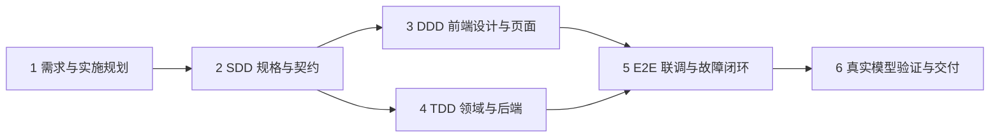

# 分阶段实施计划

日期：2026-10-08。当前只执行阶段 1；阶段 2–6 是未来计划，不构成本次实施授权。所有操作以独立项目根目录为工作目录，每阶段维护 progress、prompt-log、验收状态并提交。

## 1. 依赖与拆解原则



阶段 3、4 在契约稳定后可逻辑独立推进；默认由当前开发流程顺序执行，不自动启用并行代理。接口变更先改契约、对应测试和追溯表，再改实现。领域驱动建模贯穿阶段 2/4；附件 DDD 的前端设计工作在阶段 3 留证。

每阶段结束门槛：本阶段检查通过 → 审查变更/敏感内容 → 更新过程与 Prompt 记录 → 只暂存相关文件 → Git 提交 → 核对分支、提交与工作区。失败时保持阶段未完成，说明阻塞与补救，不越过验收门槛。

## 2. 阶段任务与验收

| 阶段 | 输入与依赖 | 工作及产物 | 验收出口 | 提交建议 |
|---|---|---|---|---|
| 1 需求分析与实施规划 | U1/U2、附件、初始目录状态 | requirements、acceptance、plan、decisions、AGENTS、progress、prompt-log、.gitignore；main 独立仓库 | 48 条来源要求均有验收映射；用户流程/状态/异常/范围/决策/Q 齐全；忽略规则正反例通过；只存在规划文件；无远程；首次提交 | docs: establish requirements and implementation plan |
| 2 SDD：规格、领域模型与 API | 阶段 1；获得继续实施指令；核对 Q-02～Q-06、Q-08、Q-10 | 固化人数/终止/重试规则；API/OpenAPI、SSE JSON Schema 与示例、最终 ER、迁移策略、状态矩阵、错误码、分句规则；确定依赖版本；定义测试替身契约 | 每个动作/状态/事件可映射需求与验收；快照游标、幂等、隔离/失败语义无歧义；契约正反例校验通过；未决范围有明确处理 | docs/schema: define domain and API contracts |
| 3 DDD：设计驱动前端组件与页面 | 阶段 2 契约和视口/交互基线 | 用户流程线框与状态稿；React/TS/Vite 页面骨架；首页、创建、阵容确认、演播厅、总结；角色卡/转录/洞察/连接状态组件；显式假数据适配 | 类型检查/构建通过；三种视口无整页溢出；中文、内部滚动、空态/失败态可见；假数据明确标记，UI 不声称真实模型已通 | ui: build discussion flow and studio components |
| 4 TDD：领域规则、持久化与模型接口 | 阶段 2；前端进度不阻塞领域规则 | 分小批 red→green→refactor；领域状态/阵容校验/意图仲裁/提炼来源/结束策略；FastAPI 命令查询；SQLite 初始化/迁移；受监管任务；ModelGateway 与替身；持久化事件 | 核心规则 pytest 通过；真实 SQLite 隔离/唯一约束/原子事件/重启测试通过；HTTP 假上游测试覆盖超时/格式/重试；先失败证据可追踪 | tests: specify core rules；feat: implement tested orchestration（按实际批次提交） |
| 5 E2E：联调与质量闭环 | 阶段 3+4；稳定契约 | 真前端+真后端+临时 SQLite+确定性模型替身；SSE 恢复；跨页双讨论隔离；响应式；密钥哨兵；故障注入；修复回归 | AC-F01～F15 结构/行为部分、AC-T02～T05、AC-R01～R10 适用项通过；记录未满足质量/真实性部分；类型/构建/后端测试和 Playwright 全链路通过 | test/e2e: cover discussion lifecycle and recovery；fix: … |
| 6 真实模型、样例和最终交付 | 阶段 5；Q-09 服务配置/预算；Q-01/Q-07 最终要求 | 接入指定运行时服务；至少 5 个议题/嘉宾样例；真实冒烟与内容复核；README/API/ER 与实现对齐；≥5 实际 Prompt；1–1.5 页过程说明；交付包；经授权再创建远程/上传 | 干净环境按 README 完整运行；真实服务与替身验收分开；材料 D-01～D-11 逐项检查；无密钥/运行库；阻塞项未解决不得宣称最终全部完成 | docs: finalize verified delivery and workflow |

## 3. TDD 工作包与测试分层

| 顺序 | 先失败测试 | 最小实现后通过条件 |
|---|---|---|
| TDD-1 | 空白议题、人数越界、阵容数量错误、重复角色/色标、未确认启动 | 输入/阵容校验及生命周期纯领域规则成立 |
| TDD-2 | 同时抢答、无候选、反驳响应目标不存在、占用过多、跨议题意图 | 基于有效意图的调度，非固定轮流，合法主持回退，无越界目标 |
| TDD-3 | 多句/空发言、重复 commit、旧 run 回调、终态后发言 | 接受合规公开发言，提交顺序唯一，过期回调不改状态 |
| TDD-4 | 洞察跨议题引用、引用未来 turn、旧版本覆盖、无共识 | 只从已提交来源提炼，空共识合法，幂等更新 |
| TDD-5 | 达上限、总结失败/重试、进程重启、SQLite 提交失败 | 有界结束、总结独立重试、已提交数据保留、无假完成事件 |

单元层测试规则，不调用数据库/网络。集成层真实 SQLite + FastAPI + 模型替身/假上游，验证事务、配置、协议、错误与隔离。E2E 层从真实浏览器操作，等待可观察的 UI 状态与事件，不能把全后端替换掉后宣称完整链路通过。真实模型层独立标记 opt-in，避免无密钥环境无法回归。

不为文档或可逆低影响样式强造业务测试；阶段 1 用文件、编号、引用、Git/忽略规则和人工一致性检查。覆盖率数字不能替代关键行为测试；阶段 2 依据已冻结规则确定必要分支，而非先承诺任意百分比。

## 4. 未来目录方向（本阶段不创建源码空壳）

```text
ai-panel-studio/
  AGENTS.md
  .gitignore
  .env.example                  # 后续创建，只含占位配置
  README.md                     # 后续实际运行方式确定后编写
  docs/                         # 当前规划及持续记录
  frontend/                     # 后续 React 页面/组件/协议类型
  backend/                      # 后续 domain/application/infrastructure/api
  tests/                        # 后续单元/集成及 Playwright 场景
  db/migrations/                # 后续文本 SQL 或迁移代码
  data/samples/                 # 后续至少 5 份可重现文本样例
  work/                         # 本地临时证据，忽略
```

## 5. 时间与交付安排

附件提及“收到后 72 小时”，当前缺少确切起算时间，因此不写伪确定的日历截止。建议把已确认可用时间按阶段 1/2/3/4/5/6 约 10%/15%/15%/30%/20%/10% 分配；这是排期建议，不是工时承诺。核心风险优先在阶段 2/4 暴露：模型调用预算、非轮流调度、SSE 恢复、多议题隔离。

若时间紧，削减范围外体验，不删附件硬要求，不跳过关键测试，也不把静态样例宣传为动态生成。每次收缩范围同步 requirements、acceptance、decisions。

下一阶段首先冻结输入/结束策略、领域状态及 API/SSE 契约；在获得继续实施指令前，不安装依赖、不生成脚手架、不接入真实模型。
